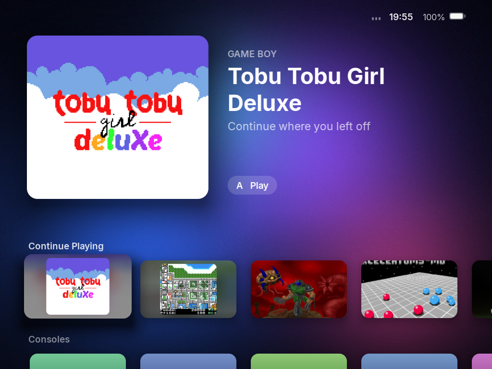
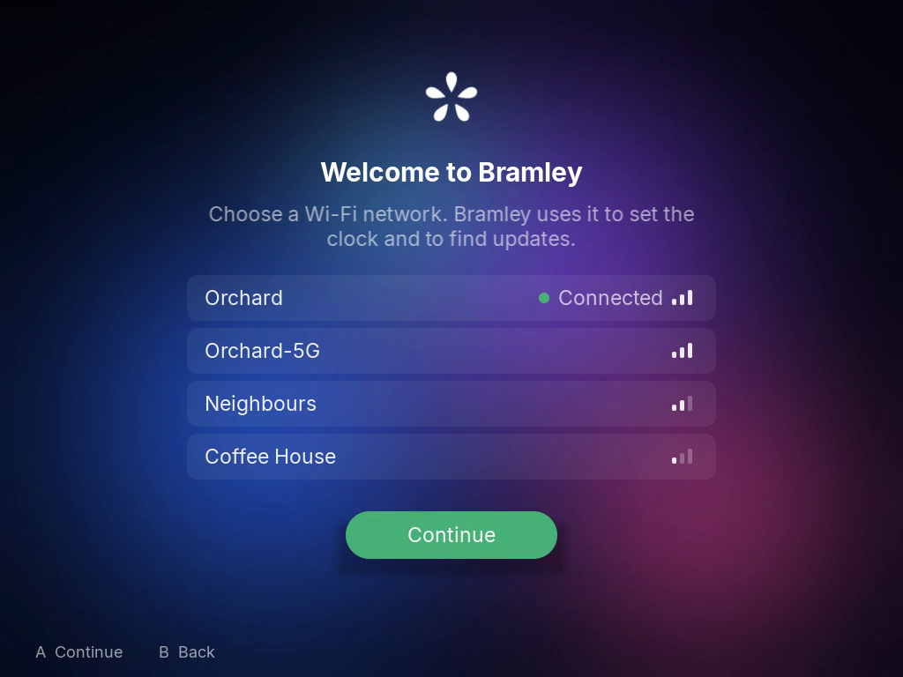
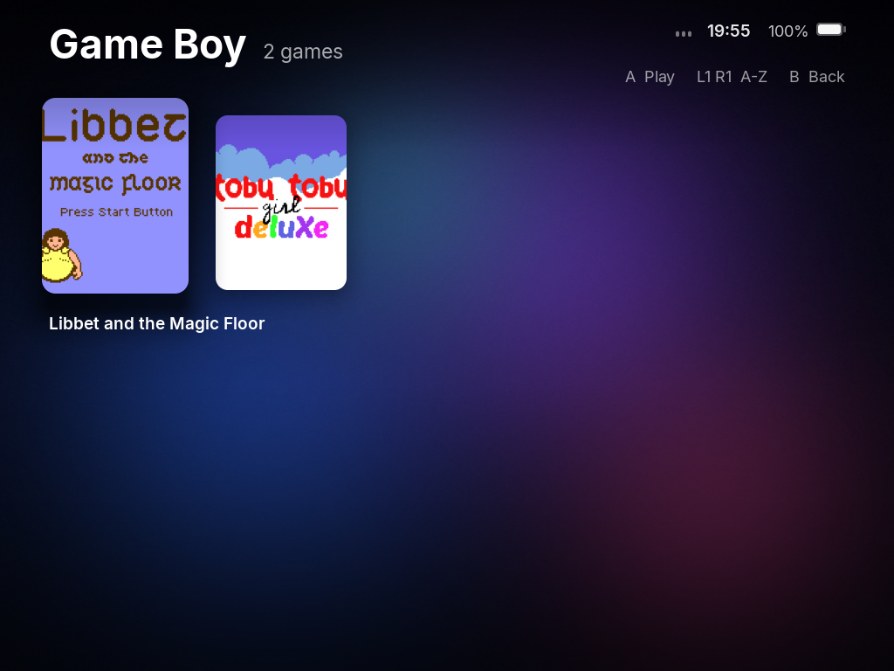
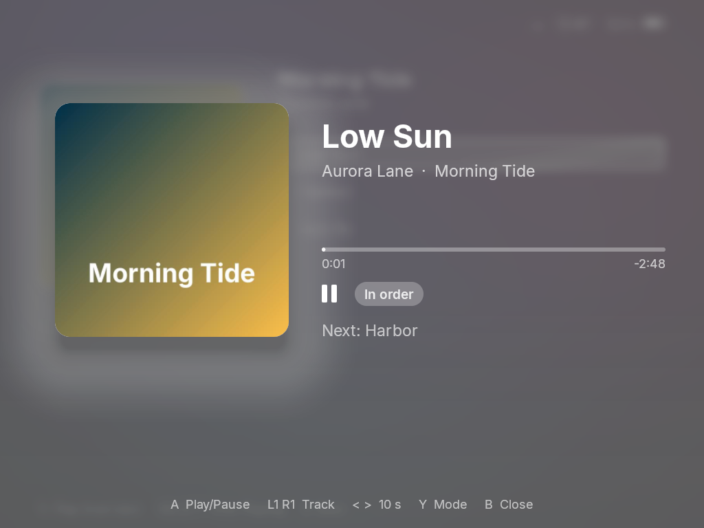
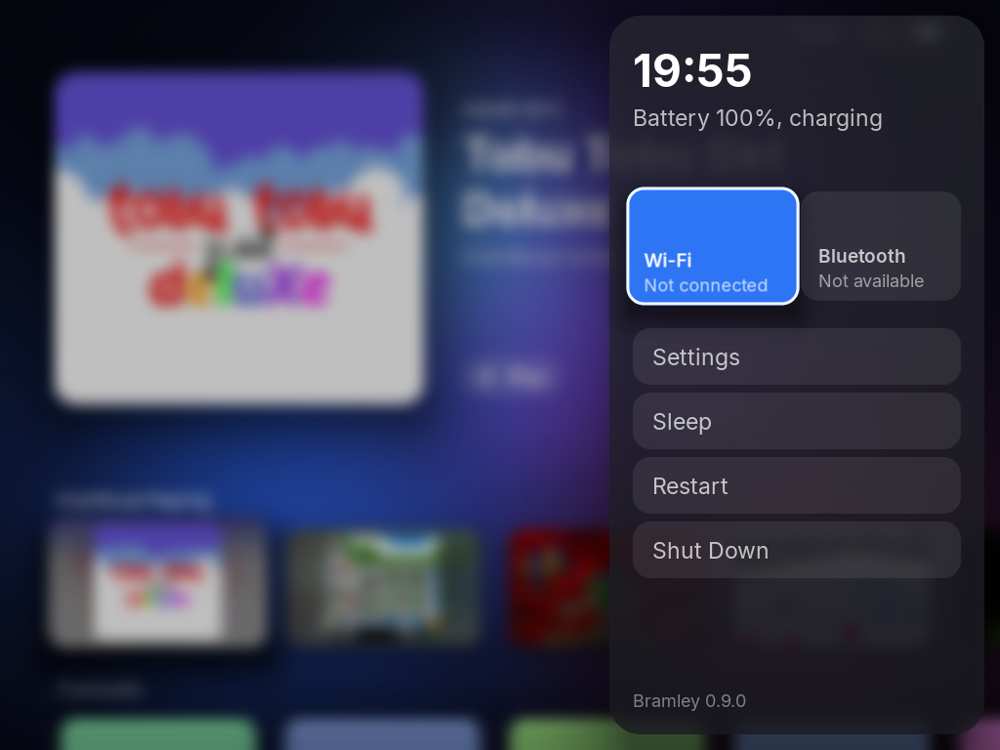
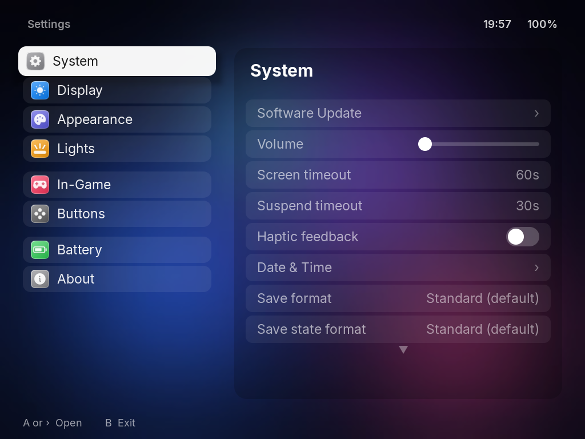
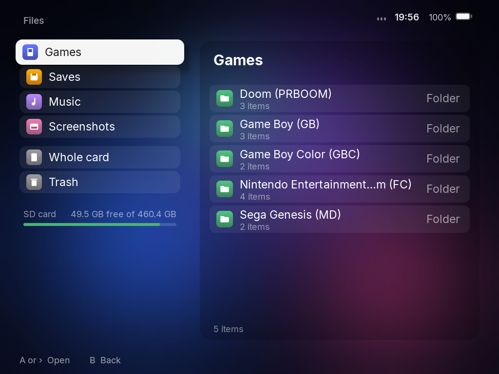

# Bramley

An Apple-inspired system for the TrimUI Brick and Brick Hammer.
Free, and not for sale.

[Download the latest release](https://github.com/howardhwt/bramley/releases/latest)

  
  

Bramley turns the Brick into a calm, quick handheld that feels like an Apple device. The home screen lifts what you focus on, Settings is a split view like an iPad's, and music plays from anywhere. It is a full system: copy it to a card and it starts on its own.

Bramley is forked from [NextUI](https://github.com/LoveRetro/NextUI), and NextUI's emulation engine, cores and device support still sit underneath. Everything you see and touch is redrawn.

## What's in it

- **Home.** Continue Playing, your consoles, collections and apps, in rows that lift and glide as you move, over a softly blurred wallpaper.
- **Game libraries.** Box art for each console, a styled card when art is missing, and L1 and R1 to jump through the alphabet.
- **Music and audiobooks.** A full player with albums, artists and audiobooks that remember your place. SELECT opens Now Playing from anywhere, a game pauses the music, and you can resume it afterwards.
- **Quick menu.** MENU opens Wi-Fi, Bluetooth, Settings, Sleep, Restart and Shut Down from anywhere.
- **Settings.** A split view with Wi-Fi, Bluetooth, Display, Wallpaper, Lights, Battery history, Date and Time with a list of cities, Buttons with a button tester, and Software Update.
- **Files.** Browse the whole card, copy, move and rename, with a Trash that keeps deleted files until it is emptied. Saves are protected.
- **Activity.** Time played per day and per game.
- **In-game menu.** Redrawn to match, with save states, achievements and quiet notifications.
- **First-boot setup.** Welcome to Bramley asks for Wi-Fi and your time zone, then shows how MENU and SELECT work.
- **Software Update.** Finds new versions on GitHub, downloads them over Wi-Fi with a checked SHA-256, and installs them on restart. It checks quietly once a day while Wi-Fi is on and never downloads without asking.
- **Start-up screens.** The device turns on to Bramley's mark, and the start-up pictures can be switched back to TrimUI's in Settings > About.

  
  
  

  
  

## Install

Bramley runs on the **TrimUI Brick** and **Brick Hammer** only.

**On a new card**

1. Format a card as FAT32.
2. Download `Bramley-<version>-card.zip` from the [latest release](https://github.com/howardhwt/bramley/releases/latest) and extract everything in it to the top of the card.
3. Put the card in the device and turn it on. "Setting up Bramley" shows for about a minute, then Welcome to Bramley starts.

**From NextUI, or from Bramley 0.x (the Pak)**

Extract the card zip over your card, replacing files when asked, and restart. Saves, games, music and settings stay. On its first start Bramley tidies the card once: it removes NextUI's files for other devices, the NextUI apps Bramley replaces (including NextUI's Updater) and the old Bramley Pak. Apps you added stay, and the list of what was removed is in `.userdata/shared/.bramley/migrate.log`.

**Updates** come through Settings > System > Software Update.

**To go back to TrimUI's own system**, use Settings > About to put TrimUI's start-up screens back, then delete the `.tmp_update` folder from the card.

## Your card

| What | Where |
|---|---|
| Games | `Roms/<Console name> (<TAG>)/`, for example `Roms/Game Boy (GB)/` |
| Box art | `Roms/<Console>/.media/<game name>.png` |
| Console icons | `.media/consoles/<TAG>.png` at the top of the card |
| BIOS files | `Bios/<TAG>/` (none are included) |
| Music | `Music/<Artist>/<Album>/` or `Music/<Album>/`, with an optional `cover.jpg` |
| Audiobooks | `Audiobooks/<Author>/<Book>/` or `Audiobooks/<Book>/` |
| Wallpapers | `Wallpapers/` |
| Fonts | `Fonts/` with Regular, SemiBold and Bold files, to use a font you own instead of Inter |

## Buttons

| Where | Button | Does |
|---|---|---|
| Anywhere | MENU | Quick menu |
| Anywhere | SELECT | Now Playing |
| Home | A / X | Open or play / resume a manual save |
| Library | L1, R1 | Jump A to Z |
| Now Playing | A, L1 and R1, left and right | Play or pause, track, 10 seconds |
| Music playing | Power, short press | Screen off, music keeps going |
| In a game | MENU | In-game menu |

## Status

Bramley 0.9 is a beta. Please report problems as [GitHub issues](https://github.com/howardhwt/bramley/issues) with your Bramley version (Settings > About) and what you did.

## Building

Bramley builds like NextUI, inside the tg5040 toolchain container (Docker or OrbStack). `workspace/all/launcher/card.sh` builds a whole card; it needs the emulator cores built first, from `workspace/tg5040/cores`, where every core is pinned to an exact upstream commit. A desktop build for macOS runs the launcher and Settings in a window for quick work on the interface. Details are in [CLAUDE.md](CLAUDE.md).

## Licences and credits

Bramley is free and not for sale, under the [PolyForm Noncommercial License 1.0.0](LICENSE), the same licence as NextUI. See [NOTICE](NOTICE).

- [NextUI](https://github.com/LoveRetro/NextUI) by the LoveRetro team and contributors, itself a fork of [MinUI](https://github.com/shauninman/MinUI) by Shaun Inman.
- The emulator cores keep their own licences, mostly the GNU GPL. Each card lists the exact source of every core in `CORES-SOURCE.md` and includes each core's licence in `Licenses/`. See [docs/plans/cores-licenses.md](docs/plans/cores-licenses.md).
- The music player is based on Muse from [TortOS](https://github.com/ericreinsmidt/TortOS) by Eric Reinsmidt (MIT).
- The interface font is [Inter](https://github.com/rsms/inter) (SIL Open Font License).
- Screenshots show free homebrew games, credited in [spikes/demo-library/CREDITS.md](spikes/demo-library/CREDITS.md).

Full third-party notices are in [THIRD-PARTY-LICENSES.md](THIRD-PARTY-LICENSES.md).

Bramley is not affiliated with Apple, TrimUI, NextUI or the authors of the games shown.
