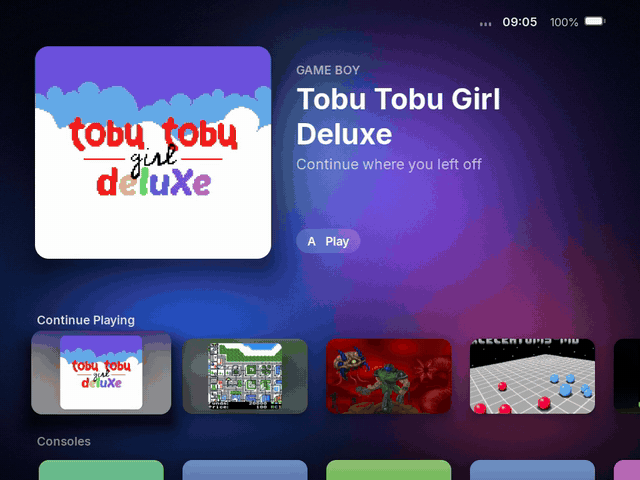

# Bramley

**A calm, refined system for the TrimUI Brick.**

[**Download the latest release**](https://github.com/howardhwt/bramley/releases/latest)

Bramley is a complete system for the TrimUI Brick and Brick Hammer, designed in the spirit of Apple's tvOS and iOS: focus that lifts and glides, a split-view Settings, music that follows you everywhere, and a setup that asks only what it needs. Copy it to a card and it starts on its own. It is free and never sold.

## Install

1. Format a card as **FAT32**.
2. Extract everything in `Bramley-<version>-card.zip` from the [latest release](https://github.com/howardhwt/bramley/releases/latest) to the top of the card.
3. Put the card in the device and turn it on. "Setting up Bramley" shows for about a minute, then Welcome to Bramley asks for Wi-Fi and your time zone.

Cards over 32 GB: macOS formats them as FAT32 in Disk Utility (MS-DOS (FAT)). Windows cannot do this itself; a tool such as Rufus can.

**Coming from NextUI, or Bramley 0.x (the Pak)?** Extract the card zip over your card, replacing files when asked, and restart. Saves, games, music and settings stay. On its first start Bramley tidies the card once, removing NextUI's files for other devices, the NextUI apps it replaces and the old Pak, and lists what it removed in `.userdata/shared/.bramley/migrate.log`.

**Updates** come through Settings > System > Software Update.

## What's in it

- **Home.** Continue Playing, consoles, collections and apps, over a softly blurred wallpaper.
- **Game libraries.** Box art for every console, with L1 and R1 to jump through the alphabet.
- **Music and audiobooks.** Albums, artists and books that remember your place. SELECT opens Now Playing from anywhere; starting a game pauses the music.
- **Quick menu.** MENU opens Wi-Fi, Bluetooth, Settings, Sleep, Restart and Shut Down.
- **Settings.** Wi-Fi, Bluetooth, Display, Wallpaper, Lights, Battery history, Date & Time, Buttons with a button tester, and Software Update.
- **Files.** Browse the card, copy, move and rename, with a Trash. Saves are protected.
- **Activity.** Time played per day and per game.
- **In-game menu.** Save states, achievements and quiet notifications, redrawn to match.

  
  
  

More screenshots

  
  
  
  

## Supported systems

Put games in `Roms/<System> (<TAG>)/`, for example `Roms/Game Boy (GB)/`, and BIOS files in `Bios/<TAG>/`. No BIOS files are included.

| Maker | System | Tag | BIOS |
|---|---|---|---|
| Nintendo | NES / Famicom | FC | |
| | Famicom Disk System | FDS | `disksys.rom` |
| | Super NES | SFC, SUPA | |
| | Game Boy, Game Boy Color | GB, GBC | optional |
| | Game Boy Advance | GBA, MGBA | `gba_bios.bin` for GBA (gpSP); optional for MGBA |
| | Super Game Boy | SGB | optional |
| | Virtual Boy | VB | |
| | Pokémon mini | PKM | optional |
| Sega | Master System, Game Gear, SG-1000 | SMS, GG, SG1000 | |
| | Mega Drive / Genesis, 32X | MD, 32X | |
| | Sega CD / Mega-CD | SEGACD | `bios_CD_U.bin`, `bios_CD_E.bin` or `bios_CD_J.bin` |
| Sony | PlayStation | PS | recommended: `scph5500.bin`, `scph5501.bin`, `scph5502.bin` |
| NEC | PC Engine / TurboGrafx-16 | PCE | `syscard3.pce` for CD games |
| SNK | Neo Geo Pocket, Pocket Color | NGP, NGPC | |
| | Arcade (FinalBurn Neo) | FBN | `neogeo.zip` for Neo Geo games |
| Atari | 2600, 5200, 7800, Lynx | A2600, A5200, A7800, LYNX | optional for 5200, 7800 and Lynx |
| Commodore | Amiga | PUAE | Kickstart ROMs, such as `kick34005.A500` |
| | C64, C128, VIC-20, PET, Plus/4 | C64, C128, VIC, PET, PLUS4 | |
| Others | ColecoVision | COLECO | `colecovision.rom` |
| | MSX | MSX | blueMSX's `Machines` and `Databases` folders |
| | Amstrad CPC | CPC | |
| | PICO-8 | P8 | |
| | Doom | PRBOOM | `prboom.wad` next to the game |

## Your card

| What | Where |
|---|---|
| Box art | `Roms/<System>/.media/<game name>.png` |
| Console icons | `.media/consoles/<TAG>.png` at the top of the card |
| Music | `Music/<Artist>/<Album>/` or `Music/<Album>/`, with an optional `cover.jpg` |
| Audiobooks | `Audiobooks/<Author>/<Book>/` or `Audiobooks/<Book>/` |
| Wallpapers | `Wallpapers/` |
| Fonts | `Fonts/` with Regular, SemiBold and Bold files, to use a font you own instead of Inter |

## Buttons

| Where | Button | Does |
|---|---|---|
| Anywhere | MENU | Quick menu |
| Anywhere | SELECT | Now Playing |
| Home | A, X | Open or play, resume a manual save |
| Library | L1, R1 | Jump A to Z |
| Now Playing | A; L1, R1; left, right | Play or pause; track; 10 seconds |
| Music playing | Power, short press | Screen off, the music keeps going |
| In a game | MENU | In-game menu |

## Known issues

- **Wi-Fi on a busy 2.4 GHz network can be slow,** which makes the first update take a while. Software Update keeps the device awake and resumes a dropped download by itself.
- **The first update** on a card from 0.9.1 or earlier downloads the whole 58 MB card. Later updates are usually about 14 MB.
- **RetroAchievements sign-in** can freeze the screen for a few seconds while it connects.
- **Console tiles** show the short tag (GB, MD) until you add console icons.

## FAQ

**Does it work on the Brick and the Brick Hammer?** Yes, both. They share the same hardware. Other TrimUI devices and Anbernic devices are not supported.

**Do my NextUI Paks still work?** Yes. Paks for tg5040 in `Tools/tg5040/` and `Emus/tg5040/` work as before; Tool Paks show in the Apps row.

**Where is the Pak Store?** Bramley does not include it. Copy Paks to the card by hand.

**How do I go back to TrimUI's own system?** Use Settings > About to put TrimUI's start-up screens back, then delete the `.tmp_update` folder from the card.

**Can I donate?** No. Bramley is free and never sold, and it asks for nothing. The arcade core's licence also forbids asking for donations for projects that use it.

**Why fork NextUI?** NextUI has an excellent emulation engine. Bramley keeps it and rebuilds everything you see and touch around a different idea of what a handheld should feel like.

## Building

See [docs/BUILDING.md](docs/BUILDING.md).

## Licences and credits

Bramley is free and not for sale, under the [PolyForm Noncommercial License 1.0.0](LICENSE), the same licence as NextUI. See [NOTICE](NOTICE).

- [NextUI](https://github.com/LoveRetro/NextUI) by the LoveRetro team and contributors, itself a fork of [MinUI](https://github.com/shauninman/MinUI) by Shaun Inman.
- The emulator cores keep their own licences, mostly the GNU GPL. Each card lists the exact source of every core in `CORES-SOURCE.md` and includes each core's licence in `Licenses/`. See [docs/plans/cores-licenses.md](docs/plans/cores-licenses.md).
- The music player is based on Muse from [TortOS](https://github.com/ericreinsmidt/TortOS) (MIT).
- The interface font is [Inter](https://github.com/rsms/inter) (SIL Open Font License).
- Screenshots show free homebrew games, credited in [spikes/demo-library/CREDITS.md](spikes/demo-library/CREDITS.md).

Full third-party notices are in [THIRD-PARTY-LICENSES.md](THIRD-PARTY-LICENSES.md).

Bramley is not affiliated with Apple, TrimUI, NextUI or the makers of the games shown. Apple, tvOS and iOS are trademarks of Apple Inc.
